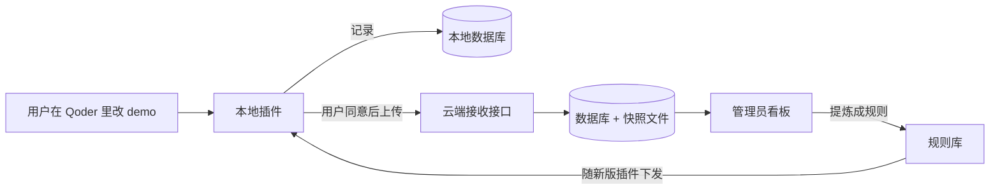
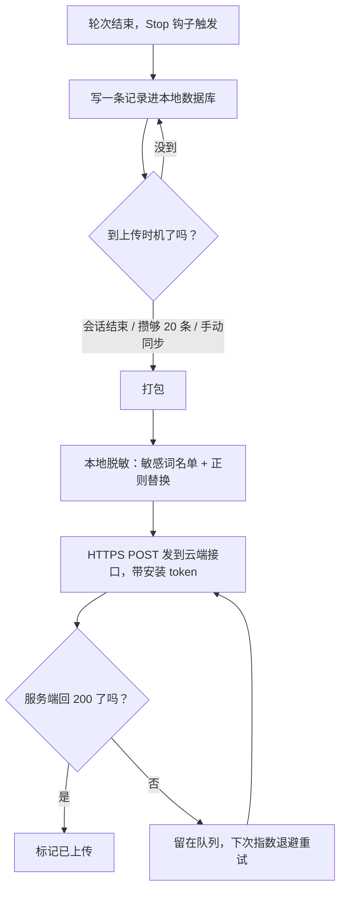
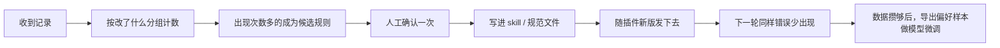

# 设计判断回传链路：具体实现路径

> 一句话结论：本地插件把用户每轮迭代的判断记下来，经用户同意后传回云端，云端把高频判断变成规则再发回去。这条路每一步都有现成做法或跑通过的原型，唯一要自己搭的是"记录→回传"这一段，而这一段我已经在本地跑通过。

## 1. 全局长什么样



整套东西就四块：本地插件、云端接收接口、数据库、管理员看板。箭头只有两条：记录往上走，规则往下走。

## 2. 插件怎么做

按 Qoder 官方插件结构做。插件包里唯一必需的文件是 `.qoder-plugin/plugin.json`，里面写名字、版本和各部分的路径；其他目录都是可选的：`skills/`（技能说明）、`rules/`（规范）、`agents/`（子智能体）、`commands/`、`hooks/hooks.json`（钩子）、`mcp.json`（外部工具配置）。打成 `.zip` 分发，用户从插件市场或设置里的 Import 安装，`mcp.json` 会随插件自动加载。

记录器挂在钩子上。钩子就是"某件事发生时自动跑一段代码"，我们用四个：

| 钩子 | 干什么 |
| --- | --- |
| UserPromptSubmit | 用户一发消息，就把原话记下来 |
| Stop | 每轮 agent 回答结束时触发，写一条完整记录 |
| SessionEnd | 会话结束时收尾，标出哪一版是最终版 |
| SessionStart | 启动时把上次没传完的补上 |

钩子脚本从标准输入读 JSON，里面有会话编号、对话记录路径，工具调用类的钩子还带工具名和改动内容。几十行 Python 就够，注册方式是在 `hooks/hooks.json` 里声明事件，`plugin.json` 里用 `"hooks": "./hooks/hooks.json"` 指过去。

## 3. 一条记录长什么样

每轮迭代记一条，四个东西绑在一起，少一样以后就分析不了：

```json
{
  "user_id": "u_001",
  "session_id": "s_001",
  "round": 3,
  "user_text": "把主按钮改成描边样式",
  "demo_snapshot": "snapshots/s_001_r3.html",
  "diff": "button: solid -> outline",
  "result": "accepted",
  "created_at": "2026-11-05T10:00:00+08:00",
  "plugin_version": "1.2.0"
}
```

`user_text` 是用户原话，判断藏在原话里，不要概括改写。`demo_snapshot` 是当时 demo 的快照文件，记录里只存路径，没有它原话就没上下文。`diff` 是改了什么，机器可以自动算。`result` 只有两种值：接受或打回，成对出现就是现成的好坏样本。

如果用 Langfuse 当云端，格式不用变：一条迭代记一条 trace，原话、改动、结果全塞进 metadata（它是任意 JSON），接受/打回记成 score。

## 4. 数据怎么传回来



触发条件有三个：会话结束时自动传这一次的增量，攒够比如 20 条自动传一次，用户在设置里点立即同步。传之前先检查开关，用户没同意，数据就只留在本地。

脱敏在本地、发出之前做：一份敏感词名单（客户名、项目名这类）加正则（手机号、邮箱），命中替换成 `***`。名单文件随插件下发，管理员可以在云端更新。

能收的数据就两类：一类是上面那样的结构化小数据，直接进数据库；另一类是 demo 快照文件，存对象存储。不收也不碰的：用户整个代码库、账号密码。

## 5. 云端收到后怎么办

接收接口只干三件事：验身份、验格式、存。JSON 进数据库，快照文件进对象存储。管理员看板直接读这个库，按"改了什么"分组计数，出现次数多的就是候选规则。



规则怎么提炼，抄两家开源的现成逻辑。Agentic Cortex 把一次用户纠正存成"规则 + 理由 + 适用范围"三件套，每次会话自动加载，作者原话是"权重不变，变的是提示词"。ClawHub 的 self-improving 定了条晋升线：同一模式 7 天出现 3 次就转正为常驻规则，30 天不用降级，90 天不用归档。注意这两家都是只做本地、不管上传，正好和 Langfuse 互补：本地沉淀抄它们，回传抄 Langfuse。

调优分两层，先后顺序不要反。前期只改规则，零训练成本、当天见效；数据攒够之后，再把"接受 vs 打回"成对的样本导出来做模型微调。

## 6. 动手顺序

先让钩子把记录写下来，再把上传接通，最后做云端看板和规则提炼。每步都能独立验证：第一步看本地数据库有没有记录，第二步看云端收没收到，第三步看规则有没有真的发下去。

这套逻辑我已经在本地用 6 个 Python 标准库文件跑通过：记 3 轮（接受、打回、接受）→ 自动上传 → 云端接收 → 管理员看板分组计数，脱敏也验证了，"联系XX银行"存到云端变成了"联系***"。原型代码在 `workspace/judgment-pipeline-proto/`，跑 `python3 demo.py` 就能看到全过程。

## 7. 证据和出处

- Qoder 插件与 Hooks：docs.qoder.com/qoder-plugins、docs.qoder.com/extensions/hooks（官方文档，已打开核实）
- Agentic Cortex：github.com/Albert-Ying/agentic-cortex（24 stars，MIT；明确只做本地，不做云同步）
- ClawHub self-improving：clawhub.ai/ivangdavila/skills/self-improving（晋升与衰减规则已打开核实；它明确不发网络请求）
- Langfuse 上报：langfuse.com/docs；上报接口与鉴权细节引自一份已打开的第三方 Langfuse 技能文档，官方 API 参考页未逐页核实
- Copilot：AAAI 2024 论文，收集"输入 + 建议 + 接受/拒绝"三元组训练模型（与本方案的记录格式最接近的公开证据）
- Vercel v0：官方博客，用用户反馈追踪反复被纠正的错误，后来用强化微调训了专修模型
- DKB × Langfuse：官方 case study，600 万客户全量记录，AI 打分、专家复核、攒数据集改提示词、发版前回归测试
- 飞书智能伙伴协议 §2.8/§2.9：点赞点踩去标识化收集用于改进功能，但默认不拿来训练模型
- 钉钉算法服务说明：去标识化咨询内容抽样用于智能客服模型训练

## 8. 没验证、要自己做的部分

如实列出三处：第一，"原话 + demo 快照 + 改动 + 接受/打回"四样绑一条的存储格式，没有产品公开过完全对应的结构；第二，设计类评论自动变成规则，通用场景有人验证过，设计工具里没有公开案例；第三，自动上传通道的技术细节，公开资料里只有协议层面的"同意 + 去标识化"文字。这些就是要自研、也是做出来能领先的地方。
